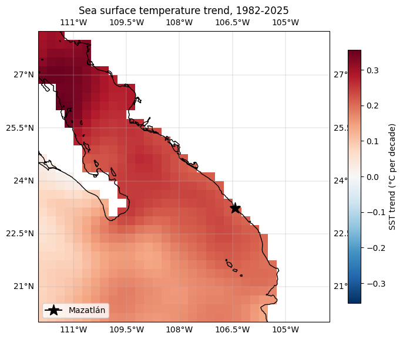
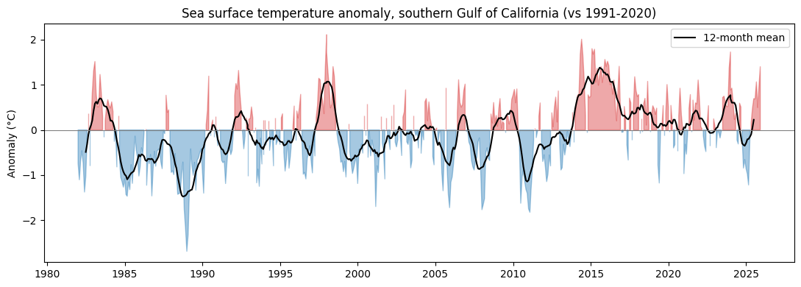

# Sea Surface Temperature Trends in the Southern Gulf of California (1982–2025)

How much has this area warmed over four decades, and where is it warming fastest?

## key findings
- The region warmed by **[0.19]°C per decade** (0.83°C total, 1982–2025; p =  0.0010).
- The trend seems to be stronger near the coast compared to open water (there could be many factors affecting this though)
- Observing the anual trend graph, the years where SST seems lower correspond to cooling trends/la Niña events (ie 1998-1999)

## data
NOAA OISST v2.1: daily, 0.25° resolution, ERDDAP server.
Region: 20–28°N, 112–104°W. Aggregated to monthly means.

## method (simplified)
1. Downloaded daily SST in yearly chunks and averaged to monthly values (`download_data.py`).
2. Computed a regional mean and anomalies against a 1991–2020 monthly baseline.
3. Fitted a linear trend to annual means (OLS regression).
4. Repeated the fit for every grid cell to map where warming is concentrated.

## limitations
- OISST blends satellite and in-situ data and is coarse (~25 km), so it can't resolve coastal features.
- Linear trends over 44 years are influenced by El Niño/La Niña variability and the chosen period.
- Annual means were used for significance testing because monthly values are autocorrelated.
- This is just an example for my portfolio, do not reference these figures for anything. I could've had mistakes and this is most likely the case.

## reproduce
Open `notebooks/01_sst_analysis.ipynb` in Google Colab. Requires `xarray`, `netCDF4`, `scipy`, `matplotlib`, `cartopy`.

## tools I used
Python · xarray · pandas · SciPy · Matplotlib · Cartopy
